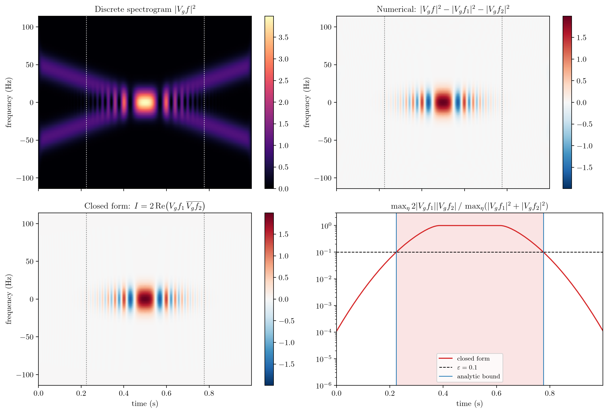
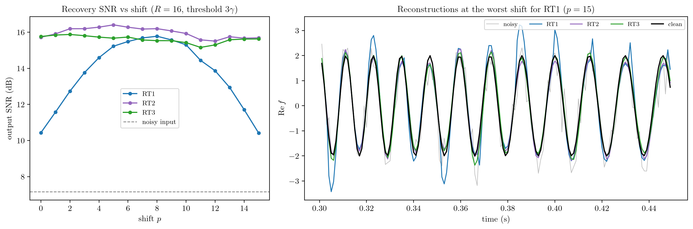
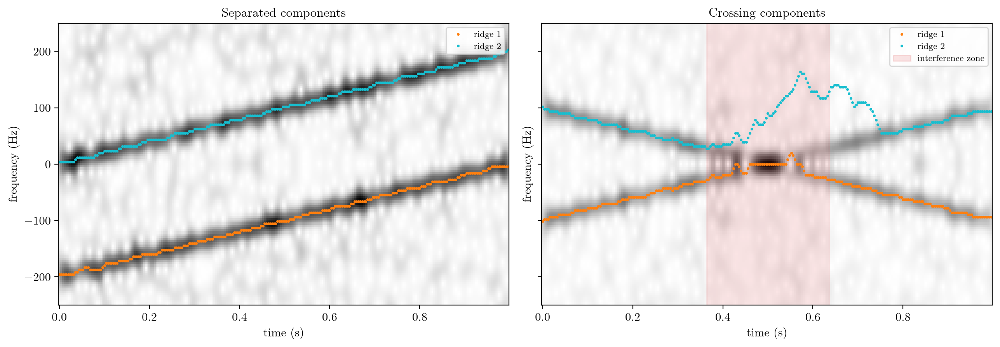

<div align="center">

# 〰️ chirp-interf 〰️

**Time-frequency analysis of multicomponent chirps : sub-sampled STFT, signal recovery from a thresholded transform, ridge extraction and closed-form interference terms.**

C++17 / OpenMP core · nanobind bindings · NumPy API · tested against an independent NumPy oracle

<br>

<table>
  <tr>
    <td align="center" valign="top" width="260">
      <a href="https://github.com/maximilien-mahdhi"></a><br>
      <b>Maximilien MAHDHI</b><br>
      <sub>Design and implementation</sub><br>
      <sub><a href="https://github.com/maximilien-mahdhi">GitHub</a> · <a href="https://www.linkedin.com/in/maximilien-mahdhi">LinkedIn</a></sub>
    </td>
  </tr>
</table>

<br>

[](https://github.com/maximilien-mahdhi/chirp-interf/actions)


<br>



<sub><code>uv run chirp-interference</code> — discrete spectrogram, numerical vs closed-form interference term, and predicted interference zone</sub>

</div>

> [!NOTE]
> This repository comes from a research internship on the time-frequency analysis of chirp signals at the [**Laboratoire Jean Kuntzmann**](https://ljk.imag.fr/) (Université Grenoble Alpes), supervised by [**Sylvain Meignen**](https://membres-ljk.imag.fr/Sylvain.Meignen/). It was started in Python, then ported to a C++ core with Python bindings.

<br>

---

## Table of contents

- [Overview](#overview)
- [Installation](#installation)
- [Quick start](#quick-start)
- [Experiments and results](#experiments-and-results)
- [Background](#background)
- [Project structure](#project-structure)
- [API reference](#api-reference)
- [Design notes and development](#design-notes-and-development)
- [References](#references)

---

## Overview

A *multicomponent signal* $`f`$ is a sum of $`K`$ modes $`f_j`$ :

```math
f = \sum_{j=1}^{K} f_j, \qquad f_j = A_j\, e^{2i\pi \phi_j(\cdot)}, \quad j \in \{1, \dots, K\},
```

with constant amplitudes $`A_j > 0`$ and phases $`\phi_j`$. The derivative $`\phi_j'`$ of each phase is the **instantaneous frequency** of the mode, and it varies in time.

Chirps (linear frequency modulations) are the simplest non-stationary case. They appear in radar, sonar, gravitational-wave detection and bio-acoustics.

This project studies them through the short-time Fourier transform (STFT) and asks four questions :

<br>

| Topic | Question | Where |
| --- | --- | --- |
| **Sub-sampled STFT** | How to compute $`V_g f`$ only on the frames $`t_m = mR + p`$, $`m \in \mathbb{Z}`$ (hop $`R`$, shift $`p`$) without losing invertibility ? | `chirp_interf.stft`, `src/stft.cpp` |
| **Recovery** | After hard-thresholding the noisy STFT at $`3\gamma`$, which inversion formula (RT1, RT2, RT3) gives the best SNR, and how much does it depend on $`p`$ ? | `chirp_interf.recovery`, `src/recovery.cpp` |
| **Ridge extraction** | Can the instantaneous frequencies be tracked on the spectrogram, and where does tracking fail ? | `chirp_interf.ridges` |
| **Interference** | For two crossing chirps, what is the exact interference term in $`\lvert V_g f\rvert^2`$, and over which time interval does it matter ? | `chirp_interf.interference` |

<br>

**Main results**

- **RT2 and RT3 are robust to the shift $`p`$, RT1 is not.**
  With $`R = 16`$ and an input SNR of 7.2 dB, RT1 varies from 10.4 to 15.8 dB depending on $`p`$. Over the same range, RT2 stays between 15.5 and 16.4 dB and RT3 between 15.2 and 15.9 dB.

- **The closed form of the Gaussian STFT of a linear chirp matches the discrete transform.**
  The gap is $`3.4 \cdot 10^{-4}`$ for a peak value of 4. The interference zone predicted analytically coincides with the one measured on the closed form.

- **Ridges follow separated components, and break at crossings.**
  Inside the interference zone, greedy tracking loses the second component.

- **The C++ core is about 10× faster than a vectorised NumPy/FFT implementation** for RT2 and RT3.
  All three techniques are exact (to $`10^{-15}`$) when nothing is thresholded.

<br>

<details>
<summary><b>Detailed values</b></summary>

<br>

| Result | Quantity | Value |
| --- | --- | --- |
| **RT1 depends on the shift $`p`$** | output SNR of RT1 over $`p \in \{0, \dots, 15\}`$ | $`[10.42,\ 15.78]`$ dB |
| **RT2 and RT3 are robust to $`p`$** | output SNR of RT2 over $`p \in \{0, \dots, 15\}`$ | $`[15.51,\ 16.41]`$ dB |
| | output SNR of RT3 over $`p \in \{0, \dots, 15\}`$ | $`[15.16,\ 15.88]`$ dB |
| | input SNR (noisy signal) | $`7.16`$ dB |
| **Exact inversion** | reconstruction error without thresholding (RT1, RT2, RT3) | $`\sim 10^{-15}`$ (tests : $`< 10^{-12}`$) |
| **Closed form = discrete STFT** | $`\max \lvert \lvert V_g f \rvert^2 - (E_1 + E_2 + I) \rvert`$ (peak $`3.99`$) | $`3.4 \cdot 10^{-4}`$ |
| **Analytic interference zone** | measured on the closed form ($`\varepsilon = 0.1`$) | $`[0.224,\ 0.776]`$ s |
| | predicted by $`\Delta(t) < \sqrt{D \ln(2/\varepsilon)} / (\pi\sigma)`$ | $`[0.224,\ 0.776]`$ s |
| **Ridges on separated components** | max error without noise | $`\le f_s / N \approx 3.9`$ Hz |
| | median / max error with noise ($`\sigma = 1`$) | $`1.3`$ Hz / $`5.9`$ Hz |
| **Ridges at a crossing** | second component lost inside the interference zone | $`[0.364,\ 0.636]`$ s |
| **C++ / OpenMP vs NumPy** | speed-up of RT1 / RT2 / RT3 | $`4.6\times`$ / $`13.7\times`$ / $`10.3\times`$ |

<br>

Settings and figures for each line are given in [Experiments and results](#experiments-and-results).

</details>

<br>

---

## Installation

You need a C++17 compiler, CMake ≥ 3.18 and Python ≥ 3.10.

OpenMP is optional (serial build otherwise).

```bash
git clone https://github.com/maximilien-mahdhi/chirp-interf.git
cd chirp-interf
uv sync                                   # or: pip install ".[test]"
```

The extension is built by scikit-build-core ; versions are pinned in `uv.lock`. With pip, drop the `uv run` prefix below.

<br>

<details>
<summary><b>Platform-specific setup</b></summary>

<br>

**Debian / Ubuntu**

```bash
sudo apt install build-essential cmake python3-venv     # GCC ships with OpenMP (libgomp)
```

**macOS (Apple Silicon or Intel)**

```bash
xcode-select --install
brew install cmake libomp                               # CMake finds Homebrew's libomp automatically
```

**Without OpenMP**

```bash
CMAKE_ARGS="-DCHIRP_USE_OPENMP=OFF" uv sync --reinstall-package chirp-interf   # with uv
pip install . -Ccmake.define.CHIRP_USE_OPENMP=OFF                                # with pip
```

</details>

<details>
<summary><b>LaTeX rendering of the figures</b></summary>

<br>

```bash
sudo apt install texlive-latex-extra texlive-fonts-recommended dvipng cm-super   # Debian / Ubuntu
brew install --cask mactex-no-gui                                                # macOS
```

Without LaTeX, figures fall back to mathtext (or pass `--no-usetex`).

</details>

<br>

---

## Quick start

### Reproduce the figures

```bash
uv run chirp-recovery          # figures/recovery.png       RT1/RT2/RT3 vs shift p
uv run chirp-interference      # figures/interference.png   closed-form interference
uv run chirp-ridges            # figures/ridges.png         ridges, separated vs crossing
uv run chirp-benchmark         # timing table               C++/OpenMP vs NumPy
```

<details>
<summary><b>Example output (<code>chirp-recovery</code>)</b></summary>

<br>

Each command lives in `chirp_interf.experiments` and logs through Rich :

```text
[20:33:11] INFO     L=1000, 2M+1=65, N=128, R=16, sigma=0.6
           INFO     exact gamma = 0.1127, threshold = 3 gamma
           INFO     input SNR: 7.16 dB
           INFO     RT1: SNR in [10.42, 15.78] dB, best p = 8
           INFO     RT2: SNR in [15.51, 16.41] dB, best p = 5
           INFO     RT3: SNR in [15.16, 15.88] dB, best p = 2
[20:33:13] INFO     figure saved to figures/recovery.png
```

</details>

Common options (same names as in fbm-wavelets) :

| Option | Default | Description |
| --- | --- | --- |
| `--output` | `figures/<name>.png` | output figure |
| `--usetex` / `--no-usetex` | `--usetex` | render text with LaTeX, or with matplotlib's mathtext |
| `--seed` | `55` | seed of the noise generator (`chirp-recovery`, `chirp-ridges`) |
| `--log-level` | `INFO` | verbosity : `DEBUG`, `INFO`, `WARNING` or `ERROR` |
| `--show` | off | open the figure in a window |

<br>

<details>
<summary><b>Options of <code>chirp-recovery</code></b></summary>

<br>

| Option | Default | Description |
| --- | --- | --- |
| `--fs` | `1000` | sampling rate (Hz) |
| `--sigma` | `0.6` | standard deviation of the additive white Gaussian noise |
| `--win` | `8` | standard deviation of the Gaussian window, in samples ($`M = \lceil 4\sigma \rceil`$) |
| `--N` | `128` | number of frequency bins ($`N \ge 2M+1`$) |
| `--hop` | `16` | downsampling factor $`R`$ ; every shift $`p \in \{0, \dots, R-1\}`$ is evaluated |
| `--estimate` | off | estimate $`\gamma`$ from the data (MAD) instead of using the exact $`\sigma \lVert g \rVert_2`$ |

</details>

<details>
<summary><b>Options of <code>chirp-interference</code></b></summary>

<br>

| Option | Default | Description |
| --- | --- | --- |
| `--fs` | `1000` | sampling rate (Hz) |
| `--rate` | `100` | chirp rate $`\lvert a \rvert`$ (Hz/s) ; the components have rates $`-a`$ and $`+a`$ |
| `--f0` | `50` | initial frequencies $`b_1 = f_0`$ and $`b_2 = -f_0`$ (Hz) |
| `--win` | `0.01` | standard deviation $`\sigma`$ of the Gaussian window (s) |
| `--N` | `512` | number of frequency bins |
| `--eps` | `0.1` | relative interference level $`\varepsilon`$ defining the zone |

</details>

<details>
<summary><b>Options of <code>chirp-ridges</code> and <code>chirp-benchmark</code></b></summary>

<br>

| Command | Option | Default | Description |
| --- | --- | --- | --- |
| `chirp-ridges` | `--sigma` | `1.0` | noise standard deviation |
| | `--win` | `0.01` | standard deviation of the Gaussian window (s) |
| | `--N` | `256` | number of frequency bins |
| | `--hop` | `4` | hop $`R`$ between frames |
| | `chirp-benchmark` | `--L` | `20000` | signal length |
| | `--N` | `128` | number of frequency bins |
| | `--win` | `8` | window standard deviation (samples) |
| | `--hop` | `4` | hop $`R`$ |
| | `--repeat` | `3` | runs per measurement (best kept) |

</details>

<br>

### Use it from Python

```python
import chirp_interf as ci
from chirp_interf import signals, windows

fs = 1000.0
t = signals.time_axis(fs, T=1.0)
f = signals.crossing_chirps(t, a=-200.0, b1=150.0, b2=-150.0)   # IF: 150 - 200 t and -150 + 200 t
noisy = signals.add_noise(f, sigma=0.6, rng=55)

g = windows.gaussian(sigma=8.0)                                 # std in samples, length 2M+1
times, freqs, V = ci.spectrogram(noisy, g, N=128, R=4, fs=fs)   # V: (N, n_frames), centred

gamma = ci.estimate_noise_level(noisy, g, N=128)                # robust estimate of sigma * ||g||_2
f_hat = ci.rt2(noisy, g, N=128, R=16, p=3, threshold=3 * gamma)
print(f"SNR: {ci.snr_db(f, noisy):.1f} dB -> {ci.snr_db(f, f_hat):.1f} dB")   # 7.2 dB -> 15.8 dB
```

<details>
<summary><b>Closed forms and ridges</b></summary>

<br>

```python
from chirp_interf import interference as itf, ridges

# Closed-form decomposition |V_g f|^2 = E1 + E2 + I for two crossing chirps (sigma in seconds)
comps = [(-200.0, 150.0), (200.0, -150.0)]
E1, E2, I = itf.decomposition(times, freqs, comps, sigma=0.008)
zones, ratio = itf.interference_zones(times, freqs, comps, sigma=0.008)   # [(0.58, 0.92)]

# Greedy ridge extraction (frequency indices, shape (K, n_frames))
jump = ridges.max_jump_for_rate(200.0, N=128, fs=fs, R=4)
rid = ridges.extract_ridges(V, K=2, max_jump=jump)
```

</details>

<br>

---

## Experiments and results

| Command | Output | Description |
| --- | --- | --- |
| `chirp-recovery` | `figures/recovery.png` | Output SNR of RT1, RT2 and RT3 for every shift $`p`$ ; reconstructions at the worst $`p`$ for RT1 |
| `chirp-interference` | `figures/interference.png` | Discrete spectrogram, numerical vs closed-form interference term, interference ratio and zone |
| `chirp-ridges` | `figures/ridges.png` | Greedy ridges on separated and on crossing components, under noise |
| `chirp-benchmark` | terminal table | Timings of the C++ core against the NumPy reference |

<br>

### Recovery from a thresholded STFT

**Setting.**

- Signal : two crossing chirps with instantaneous frequencies $`\phi_1'(t) = 150 - 200\, t`$ and $`\phi_2'(t) = -150 + 200\, t`$ (Hz), sampled at $`f_s = 1`$ kHz, with white Gaussian noise of standard deviation $`\sigma = 0.6`$.
- STFT : Gaussian window with a standard deviation of 8 samples ($`2M+1 = 65`$), $`N = 128`$, $`R = 16`$.
- Thresholding at $`3\gamma`$, using the exact $`\gamma = \sigma \lVert g \rVert_2`$.

<br>

| Technique | min SNR over $`p`$ | max SNR over $`p`$ | spread |
| --- | --- | --- | --- |
| noisy input | 7.16 dB | 7.16 dB | — |
| **RT1** | 10.42 dB | 15.78 dB | 5.4 dB |
| **RT2** | 15.51 dB | 16.41 dB | 0.9 dB |
| **RT3** | 15.16 dB | 15.88 dB | 0.7 dB |

<br>

<div align="center">

</div>

<br>

RT1 reads each sample $`n = mR + q`$ from **a single frame** and divides by $`g[q-p]`$. When $`q - p`$ moves away from the window centre, that value becomes small and the thresholding error is amplified. RT1 is therefore best for $`p \approx R/2`$ and worst at both ends.

RT2 and RT3 average over the $`\lvert \mathcal{M}_n \rvert \approx (2M+1)/R`$ frames that cover each sample, so the influence of $`p`$ almost disappears.

<br>

### Interference of two crossing chirps

**Setting.**

```math
\forall\, t \in [0, 1], \quad f(t) = e^{2i\pi \phi_1(t)} + e^{2i\pi \phi_2(t)},
\qquad \phi_1(t) = -50 t^2 + 50 t, \quad \phi_2(t) = 50 t^2 - 50 t ,
```

so that the instantaneous frequencies are

```math
\forall\, t \in [0, 1], \quad \phi_1'(t) = -100\, t + 50, \qquad \phi_2'(t) = 100\, t - 50 .
```

They cross at $`t = 0.5`$ s. The Gaussian window has standard deviation $`\sigma = 10`$ ms, and $`N = 512`$.

<br>

| Quantity | Value |
| --- | --- |
| largest gap between the discrete spectrogram and $`E_1 + E_2 + I`$ (closed form) | $`3.4 \cdot 10^{-4}`$, for a peak value of 3.99 |
| interference zone measured on the closed form ($`\varepsilon = 0.1`$) | $`[0.224,\ 0.776]`$ s |
| interference zone predicted by the analytic bound | $`[0.224,\ 0.776]`$ s |

<br>

The comparison only uses the frames whose window lies entirely inside the signal (here $`t \in [0.04,\ 0.96]`$ s) : near the edges, zero padding biases the discrete STFT. On the same frames, the interference term alone matches its closed form to $`1.7 \cdot 10^{-4}`$ (peak $`1.99`$).

<br>

### Ridge extraction

<div align="center">

</div>

<br>

**Separated components.** Without noise, both ridges stay within one bin ($`f_s/N \approx 3.9`$ Hz) of the true instantaneous frequencies (`test_ridges_follow_separated_components`). With the noise of the figure ($`\sigma = 1`$), the median error is 1.3 Hz and the largest error 5.9 Hz.

**Crossing components.** The band erased around the first ridge also erases the second component inside the interference zone, shaded in red and computed in closed form. The second ridge loses the component as it enters the zone, and only locks onto it again after the zone (around $`t = 0.75`$ s here).

<br>

---

## Background

<details>
<summary><b>Discrete STFT on a time lattice</b></summary>

<br>

Let $`f : \mathbb{Z} \to \mathbb{C}`$ be a signal of length $`L`$, that is, supported on $`\{0, \dots, L-1\}`$ :

```math
\forall\, n \in \mathbb{Z} \setminus \{0, \dots, L-1\}, \quad f[n] = 0 .
```

Let $`g : \{-M, \dots, M\} \to \mathbb{R}`$ be a window, let $`R \in \mathbb{N}^*`$ be the hop and $`p \in \{0, \dots, R-1\}`$ the shift. The frames are centred on the lattice

```math
\Lambda_{R,p} = \{\, mR + p \;:\; m \in \mathbb{Z} \,\} ,
```

and the discrete STFT is

```math
\forall\, t \in \Lambda_{R,p}, \quad \forall\, \omega \in \Big\{ \frac{k}{N} \;:\; k \in \{0, \dots, N-1\} \Big\}, \quad
V_g f(t, \omega) = \sum_{n=-M}^{M} f[t+n]\, g[n]\, e^{-2i\pi \omega n} .
```

If $`N \ge 2M+1`$, the inverse DFT of frame $`m`$ gives back the windowed segment without aliasing :

```math
\forall\, m \in \mathbb{Z}, \quad \forall\, d \in \{-M, \dots, M\}, \quad
u_m[d] = \frac{1}{N} \sum_{k=0}^{N-1} V_g f\Big(mR+p, \frac{k}{N}\Big)\, e^{2i\pi k d / N} = f[mR+p+d]\; g[d] .
```

</details>

<details>
<summary><b>Thresholding and the three recovery techniques</b></summary>

<br>

Assume that $`f`$ is observed with additive white Gaussian noise of standard deviation $`\sigma > 0`$. An STFT coefficient of the noise then has standard deviation

```math
\gamma = \sigma\, \lVert g \rVert_2 .
```

Every coefficient with $`\lvert V_g f(t, \omega) \rvert < 3\gamma`$ is set to zero, and $`\tilde u_m`$ denotes the inverse DFT of the thresholded frame $`m`$.

For $`n \in \{0, \dots, L-1\}`$, write $`n = mR + q`$ with $`(m, q) \in \mathbb{Z} \times \{0, \dots, R-1\}`$, and let

```math
\mathcal{M}_n = \{\, m \in \mathbb{Z} \;:\; \lvert n - mR - p \rvert \le M \,\}
```

be the set of frames covering sample $`n`$. The three techniques reconstruct :

```math
\forall\, n \in \{0, \dots, L-1\}, \qquad
\begin{aligned}
\textbf{RT1:} &\quad \hat f[n] = \frac{\tilde u_m[q-p]}{g[q-p]}, \\[6pt]
\textbf{RT2:} &\quad \hat f[n] = \frac{\displaystyle \sum_{m \in \mathcal{M}_n} g[n-mR-p]\; \tilde u_m[n-mR-p]}{\displaystyle \sum_{m \in \mathcal{M}_n} g[n-mR-p]^2}, \\[6pt]
\textbf{RT3:} &\quad \hat f[n] = \frac{\displaystyle \sum_{m \in \mathcal{M}_n} \tilde u_m[n-mR-p]}{\displaystyle \sum_{m \in \mathcal{M}_n} g[n-mR-p]} .
\end{aligned}
```

<br>

| | Frames per sample | Constraints |
| --- | --- | --- |
| **RT1** | 1 | $`\max(p,\, R-1-p) \le M`$ and $`\forall\, q \in \{0, \dots, R-1\},\ g[q-p] \ne 0`$ |
| **RT2** | $`\lvert \mathcal{M}_n \rvert \approx (2M+1)/R`$ | $`R \le 2M+1`$ |
| **RT3** | $`\lvert \mathcal{M}_n \rvert \approx (2M+1)/R`$ | $`R \le 2M+1`$, $`g \ge 0`$ |

<br>

RT2 uses the least-squares (canonical) dual window, and RT3 the plain overlap-add dual. When nothing is thresholded, all three are exact.

When $`\gamma`$ is unknown, it is estimated from the median absolute deviation of the real parts of the coefficients :

```math
\hat\gamma = \sqrt{2}\; \frac{1}{0.6745}\; \mathop{\mathrm{median}}\limits_{\substack{m \in \{0, \dots, N_t - 1\} \\ k \in \{0, \dots, N-1\}}} \Big\lvert \operatorname{Re} V_g f\Big(mR+p, \frac{k}{N}\Big) \Big\rvert ,
```

where $`N_t`$ is the number of frames inside the signal.

</details>

<details>
<summary><b>Closed-form STFT of a linear chirp</b></summary>

<br>

Let $`\sigma > 0`$. Take the unit-mass Gaussian window and the continuous STFT

```math
\forall\, u \in \mathbb{R}, \quad g(u) = \frac{1}{\sqrt{2\pi}\, \sigma}\, e^{-u^2 / (2\sigma^2)},
\qquad\qquad
\forall\, t \in \mathbb{R}, \quad \forall\, \eta \in \mathbb{R}, \quad V_g f(t, \eta) = \int_{\mathbb{R}} f(s)\, g(s - t)\, e^{-2i\pi \eta (s - t)}\, ds .
```

Let $`a, b \in \mathbb{R}`$ and let $`f : \mathbb{R} \to \mathbb{C}`$ be the linear chirp

```math
\forall\, s \in \mathbb{R}, \quad f(s) = e^{2i\pi \phi(s)}, \qquad \phi(s) = \frac{a s^2}{2} + b s ,
```

whose instantaneous frequency is the derivative of the phase :

```math
\forall\, s \in \mathbb{R}, \quad \phi'(s) = a s + b .
```

Define

```math
D = 1 + 4\pi^2 a^2 \sigma^4
\qquad \text{and} \qquad
\forall\, t \in \mathbb{R}, \quad \forall\, \eta \in \mathbb{R}, \quad \delta(t, \eta) = \phi'(t) - \eta = at + b - \eta .
```

Then

```math
\forall\, t \in \mathbb{R}, \quad \forall\, \eta \in \mathbb{R}, \quad
V_g f(t, \eta) = \frac{e^{2i\pi \phi(t)}}{\sqrt{1 - 2i\pi a \sigma^2}}\;
\exp\!\left( -\frac{2\pi^2 \sigma^2\, \delta(t, \eta)^2 \, (1 + 2i\pi a \sigma^2)}{D} \right),
```

and in particular

```math
\forall\, t \in \mathbb{R}, \quad \forall\, \eta \in \mathbb{R}, \quad
\lvert V_g f(t, \eta) \rvert = D^{-1/4}\, \exp\!\left( -\frac{2\pi^2 \sigma^2\, \delta(t, \eta)^2}{D} \right) .
```

At fixed $`t`$, the modulus is a Gaussian in $`\eta`$, centred on the instantaneous frequency $`\phi'(t) = at + b`$, with standard deviation $`\sqrt{D} / (2\pi\sigma)`$. The ridge therefore widens as the chirp rate grows.

</details>

<details>
<summary><b>Interference term</b></summary>

<br>

Let $`f = f_1 + f_2`$, where $`f_1`$ and $`f_2`$ are two linear chirps. By linearity of the STFT,

```math
\forall\, t \in \mathbb{R}, \quad \forall\, \eta \in \mathbb{R}, \quad
\lvert V_g f(t, \eta) \rvert^2
= \underbrace{\lvert V_g f_1(t, \eta) \rvert^2}_{E_1(t, \eta)}
+ \underbrace{\lvert V_g f_2(t, \eta) \rvert^2}_{E_2(t, \eta)}
+ \underbrace{2\, \operatorname{Re}\Big( V_g f_1(t, \eta)\; \overline{V_g f_2(t, \eta)} \Big)}_{I(t, \eta)} .
```

Consider two chirps with opposite rates $`\pm a`$ :

```math
f = f_1 + f_2, \qquad f_1 = e^{2i\pi \phi_1(\cdot)}, \quad f_2 = e^{2i\pi \phi_2(\cdot)},
```

```math
\forall\, t \in \mathbb{R}, \quad \phi_1(t) = \frac{a t^2}{2} + b_1 t, \qquad \phi_2(t) = -\frac{a t^2}{2} + b_2 t .
```

Their instantaneous frequencies and frequency gap are

```math
\forall\, t \in \mathbb{R}, \quad \phi_1'(t) = a t + b_1, \qquad \phi_2'(t) = -a t + b_2, \qquad \Delta(t) = \big\lvert \phi_1'(t) - \phi_2'(t) \big\rvert .
```

The envelope $`2\, \lvert V_g f_1 \rvert\, \lvert V_g f_2 \rvert`$ of $`I`$ peaks halfway between the two ridges. Relative to the energy of the components,

```math
\forall\, t \in \mathbb{R}, \quad r(t) = \frac{\displaystyle \max_{\eta \in \mathbb{R}} 2\, \lvert V_g f_1(t, \eta) \rvert\, \lvert V_g f_2(t, \eta) \rvert}{\displaystyle \max_{\eta \in \mathbb{R}} \big( E_1(t, \eta) + E_2(t, \eta) \big)} \approx 2\, \exp\!\left( -\frac{\pi^2 \sigma^2\, \Delta(t)^2}{D} \right) .
```

Hence

```math
\forall\, \varepsilon \in (0, 2), \quad \forall\, t \in \mathbb{R}, \qquad
r(t) > \varepsilon
\quad \Longleftrightarrow \quad
\Delta(t) < \frac{\sqrt{D \ln(2/\varepsilon)}}{\pi \sigma} .
```

Choosing $`\sigma`$ is a trade-off. A longer window sharpens the frequency localisation (the $`1/\sigma`$ factor) but widens the ridges of fast chirps (the $`\sqrt{D}`$ factor).

</details>

<br>

---

## Project structure

<details>
<summary><b>Repository layout</b></summary>

<br>

```
chirp-interf/
├── include/chirp/
│   ├── stft.hpp              # public API: SignalView / WindowView, stft_point, stft_frames
│   └── recovery.hpp          # public API: rt1, rt2, rt3 (formulas documented in the header)
├── src/
│   ├── fft.hpp               # radix-2 FFT + Bluestein for arbitrary N
│   ├── frames.hpp            # per-frame analysis (window + FFT) and synthesis (threshold + IFFT)
│   ├── detail.hpp            # parameter checks, integer helpers
│   ├── stft.cpp
│   └── recovery.cpp
├── bindings/
│   └── core.cpp              # nanobind module chirp_interf._core (zero-copy NumPy, GIL released)
├── python/chirp_interf/
│   ├── stft.py               # stft, spectrogram, frequency / time axes
│   ├── recovery.py           # rt1 / rt2 / rt3 wrappers, noise level, SNR
│   ├── ridges.py             # greedy multi-ridge extraction
│   ├── interference.py       # closed-form chirp STFT, interference term and zones
│   ├── signals.py            # chirps, FM tones, classic waveforms, noise
│   ├── windows.py            # Gaussian / rectangular windows
│   ├── reference.py          # pure-NumPy oracle used by the tests
│   ├── logger.py             # Rich terminal logging
│   ├── plotting.py           # Matplotlib / LaTeX setup, figure saving
│   └── experiments/          # chirp-* commands: figures/ and benchmark
│       ├── recovery_comparison.py
│       ├── chirp_interference.py
│       ├── ridge_extraction.py
│       └── benchmark.py
├── tests/                    # 61 pytest tests
├── figures/
├── CMakeLists.txt
├── pyproject.toml            # build, dependencies, chirp-* commands, ruff and pytest config
└── uv.lock                   # pinned dependency versions for uv
```

</details>

<br>

---

## API reference

Python functions carry NumPy-style docstrings ; the C++ API is documented with Doxygen comments in `include/chirp/`.

<br>

<details>
<summary><b>STFT</b> — <code>chirp_interf</code></summary>

<br>

| Function | Description |
| --- | --- |
| `stft(f, g, N, R=1, p=0)` | $`V[k, m] = V_g f(mR+p,\, k/N)`$ for $`k \in \{0, \dots, N-1\}`$, $`m \in \{0, \dots, N_t - 1\}`$ ; shape `(N, n_frames)` |
| `spectrogram(f, g, N, R=1, p=0, fs=1.0)` | `(times, freqs, V)` with `V` frequency-centred |
| `frequencies(N, fs)`, `frame_times(L, R, p, fs)`, `n_frames(L, R, p)` | axes and number of frames |

</details>

<details>
<summary><b>Recovery</b> — <code>chirp_interf</code></summary>

<br>

| Function | Description |
| --- | --- |
| `rt1 / rt2 / rt3(f, g, N, R=1, p=0, threshold=0.0)` | recovery from the STFT hard-thresholded at `threshold` |
| `recover(method, ...)` | dispatch by name (`"RT1"`, `"RT2"`, `"RT3"`) |
| `noise_level(sigma, g)` | exact $`\gamma = \sigma \lVert g \rVert_2`$ |
| `estimate_noise_level(f, g, N, R=1, p=0)` | MAD estimate $`\hat\gamma`$ |
| `snr_db(reference, estimate)` | $`20 \log_{10} \big( \lVert f \rVert_2 / \lVert f - \hat f \rVert_2 \big)`$ |

</details>

<details>
<summary><b>Interference</b> — <code>chirp_interf.interference</code></summary>

<br>

| Function | Description |
| --- | --- |
| `chirp_stft(t, eta, a, b, sigma)` | closed-form complex STFT of a linear chirp |
| `chirp_stft_modulus(t, eta, a, b, sigma)` | $`(t, \eta) \mapsto D^{-1/4}\, e^{-2\pi^2 \sigma^2 \delta(t, \eta)^2 / D}`$ |
| `decomposition(t, eta, [(a1, b1), (a2, b2)], sigma)` | `(E1, E2, I)` on the grid `eta × t` |
| `interference_ratio(E1, E2)` | relative interference envelope of each frame |
| `interference_zones(t, eta, components, sigma, eps=0.1)` | time intervals where the ratio exceeds `eps` |
| `symmetric_gap_threshold(a, sigma, eps=0.1)` | critical gap $`\sqrt{D \ln(2/\varepsilon)} / (\pi \sigma)`$, in Hz |
| `intervals(mask)` | maximal runs of `True`, as inclusive index pairs |

</details>

<details>
<summary><b>Ridges, signals, windows</b></summary>

<br>

| Function | Description |
| --- | --- |
| `ridges.extract_ridges(V, K, max_jump, band=None)` | `(K, n_frames)` frequency indices of the `K` ridges |
| `ridges.max_jump_for_rate(rate, N, fs, R=1)` | bins swept per frame by a chirp of the given rate |
| `ridges.band_for_window(sigma, rate, N, fs, n_std=3)` | half-width of a Gaussian ridge, in bins |
| `signals.linear_chirp(t, a, b)`, `crossing_chirps(t, a, b1, b2)`, `sinusoidal_fm(...)` | test signals |
| `signals.add_noise(f, sigma, complex_noise=False, rng=None)` | zero-mean white Gaussian noise |
| `windows.gaussian(sigma, M=None)`, `gaussian_seconds(sigma_t, fs)`, `rectangular(M)` | analysis windows |

</details>

<details>
<summary><b>Logging and plotting</b> — <code>chirp_interf.logger</code>, <code>chirp_interf.plotting</code></summary>

<br>

| Function | Description |
| --- | --- |
| `logger.setup_logging(level="INFO")` | install the Rich handler on the root logger (once, at start-up) |
| `logger.get_logger(name)` | named logger ; library modules use `logging.getLogger(__name__)` |
| `plotting.configure_matplotlib(usetex=True)` | global style, LaTeX rendering with an `amsmath` preamble |
| `plotting.save_figure(fig, path)` | create the directories, save, log the path |

</details>

<br>

---

## Design notes and development

<details>
<summary><b>Design notes</b></summary>

<br>

- **One FFT per frame.**
  The first version re-evaluated the STFT inside the reconstruction loop, which cost $`O(L \cdot N \cdot M^2 / R)`$ for RT2. Each frame is now analysed (window, then FFT) and synthesised (threshold, then inverse FFT) exactly once, for a total of $`O(L/R \cdot N \log N)`$. Frames are independent, so they run in parallel with OpenMP, each thread with its own buffers.

- **FFT for any $`N`$.**
  The core uses radix-2 when $`N`$ is a power of two and Bluestein's chirp-z algorithm otherwise (about 3× slower). Complex products are written out by hand, because `std::complex::operator*` handles NaN/inf cases per Annex G and is much slower without `-ffast-math`.

- **Boundaries.**
  The signal is zero-padded outside $`\{0, \dots, L-1\}`$. RT2 and RT3 use every frame whose support meets the signal, including frames centred outside it. Samples near the edges are therefore covered as well as the interior ones, and reconstruction stays exact up to the boundaries.

- **Correctness first.**
  Parameters are validated in C++ ($`N \ge 2M+1`$, $`p \in \{0, \dots, R-1\}`$, coverage conditions), and violations surface in Python as `ValueError`. Every C++ routine is checked against `reference.py`, which follows the formulas literally using `numpy.fft`.

- **Bindings.**
  Arrays cross the nanobind boundary without copies : outputs are wrapped in a capsule that owns the `std::vector`. The GIL is released during computations.

- **Logging.**
  Library modules only call `logging.getLogger(__name__)` and never install handlers. Scripts call `setup_logging()` once, which routes everything through Rich on stderr.

- **Figures.**
  LaTeX rendering is configured in one place (`plotting.configure_matplotlib`), with an automatic fallback to mathtext when LaTeX is missing.

- **Reproducibility.**
  Every random draw goes through `numpy.random.Generator` with an explicit seed (`--seed`, `rng=`).

- **Known limitations.**
  - The closed form only covers linear chirps under a Gaussian window.
  - The thresholding rule assumes white noise.
  - The ridge extractor is greedy, so it does not resolve crossings ; the interference analysis quantifies where it fails.

</details>

<br>

### Development

```bash
uv run ruff check .
uv run pytest -v
```

`[tool.uv] cache-keys` triggers a rebuild of the extension whenever `src/`, `include/` or `bindings/` change.

<details>
<summary><b>Test coverage</b></summary>

<br>

- **C++ vs NumPy oracle** : STFT frames and pointwise evaluation, RT1–RT3 with and without thresholding, for several $`(N, R, p)`$ ;
- **exact reconstruction** : every technique without noise, for six $`(R, p)`$ pairs ;
- **denoising** : RT2 and RT3 gain more than 5 dB over the noisy input ; the MAD estimate of $`\gamma`$ is within 5 % ;
- **closed forms** : complex STFT and modulus of one chirp, $`E_1 + E_2 + I`$ against the discrete spectrogram, and the analytic interference zone ;
- **ridges** : accuracy on separated components ;
- **validation** : errors raised for inconsistent parameters ;
- **tooling** : the logging and figure-saving helpers.

</details>

CI runs the suite on Ubuntu and macOS, with Python 3.10 and 3.12.

<br>

<details>
<summary><b>Benchmark</b> — 2-core container, L = 20 000, N = 128, 2M+1 = 65, R = 4</summary>

<br>

| Technique | C++ / OpenMP | NumPy (vectorised FFT) | Speed-up |
| --- | --- | --- | --- |
| RT1 | 5.6 ms | 26.1 ms | 4.6× |
| RT2 | 5.8 ms | 79.4 ms | 13.7× |
| RT3 | 6.4 ms | 66.0 ms | 10.3× |

<br>

Timings vary by about ±30 % from run to run on a shared machine. `OMP_NUM_THREADS` sets the number of threads.

</details>

<br>

---

## References

- S. Meignen, D.-H. Pham, [*Retrieval of the modes of multicomponent signals from downsampled short-time Fourier transform*](https://hal.archives-ouvertes.fr/hal-01850940), IEEE Transactions on Signal Processing, 2018.
- N. Laurent, S. Meignen, [*A novel ridge detector for nonstationary multicomponent signals: development and application to robust mode retrieval*](https://arxiv.org/abs/2009.13123), IEEE Transactions on Signal Processing, 2021.
- R. Carmona, W.-L. Hwang, B. Torrésani, *Characterization of signals by the ridges of their wavelet transforms*, IEEE Transactions on Signal Processing, 1997.
- K. Gröchenig, *Foundations of Time-Frequency Analysis*, Birkhäuser, 2001.
- P. Flandrin, *Time-Frequency/Time-Scale Analysis*, Academic Press, 1999.
- D. L. Donoho, I. M. Johnstone, *Ideal spatial adaptation by wavelet shrinkage*, Biometrika, 1994.
- L. Bluestein, *A linear filtering approach to the computation of discrete Fourier transform*, IEEE Transactions on Audio and Electroacoustics, 1970.